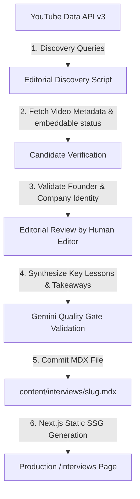

# YouTube Data API v3 Founder Talks Pipeline & Editorial Architecture

## 1. Executive Overview & Permanent Storage Model

**AI Founders Talk** provides executive-level, tactical intelligence for B2B AI founders, revenue leaders, and operators.

### Critical Database & Storage Architecture
- **Permanent Source of Truth**: All published Founder Talks, interviews, case studies, and editorial reports reside **strictly in MDX** under `content/interviews/`.
- **Zero Additional Database Tables**: The Neon Postgres database retains **EXACTLY 3 canonical tables**:
  1. `newsletter_signups` (subscribers, double opt-in confirmations, unsubscribes)
  2. `scraped_items` (external news RSS metadata & LLM summaries with automated TTL retention)
  3. `trending_items` (Hacker News Algolia & Product Hunt GraphQL launches with automated TTL retention)
- **NO `founder_talks` database table exists or will be created.** All published conversations are version-controlled MDX documents.

---

## 2. Editorial & Trust Model: Non-Deceptive Provenance

To protect journalistic credibility and comply with copyright and fair use, AI Founders Talk enforces strict content labeling:

### Approved Labeling Taxonomy
| Label | Criteria & Usage |
| :--- | :--- |
| **Founder Talk** | Public keynote, fireside chat, or presentation by an AI startup founder. |
| **Sourced Founder Interview** | Curated third-party video interview conducted by an external publisher/host. |
| **Podcast Conversation** | Episode of a public podcast featuring an AI founder or revenue executive. |
| **Conference Talk** | Presentation or panel at an industry conference. |
| **Practitioner Perspective** | Architectural case study, workflow teardown, or technical breakdown from enterprise practitioners. |
| **AI Founders Talk Original** | **STRICTLY RESERVED** for first-party interviews conducted directly by the AI Founders Talk editorial team. |

### Provenance Rules
- **NEVER** use "We sat down with", "our interview", "exclusive interview", or "we spoke with" for third-party curated content or practitioner case studies.
- **NEVER** invent founder personas, company affiliations, or fabricated quotes.
- **NEVER** republish full verbatim transcripts without express written copyright license.
- **ALWAYS** prominently display the original channel/publisher, original title, publication date, and a direct "Watch on YouTube" link.

---

## 3. YouTube Data API v3 Ingestion & Editorial Review Workflow



### 3.1 Targeted Discovery Queries
1. `"AI founder interview" "B2B"`
2. `"AI startup founder podcast"`
3. `"AI CEO fireside chat" enterprise`
4. `"AI founder conference talk"`
5. `"AI startup lessons" founder`

### 3.2 High-Relevance Authoritative Channels
- **Y Combinator** (`UCcefcZRL2oaA_uBNeo5UOWg`)
- **20VC with Harry Stebbings**
- **SaaStr**
- **AI Grant / Latent Space**
- **Sequoia Capital / Greylock / First Round Capital**

---

## 4. Published MDX Frontmatter Schema

Each selected conversation is written to `content/interviews/<slug>.mdx` with complete provenance metadata:

```yaml
---
title: "Building Enterprise AI Agents: Key Takeaways from [Founder Name] ([Company])"
slug: "building-enterprise-ai-agents-founder-talk"
pillar: "founder-interviews"
author: "editorial-team"
publishedAt: "2026-09-10"
format: "founder-talk" # founder-talk | sourced-interview | podcast-conversation | conference-talk | practitioner-perspective | original-interview
sourcePublisher: "Y Combinator"
sourceUrl: "https://www.youtube.com/watch?v=VIDEO_ID"
embedUrl: "https://www.youtube.com/embed/VIDEO_ID"
embeddable: true
speakerName: "Jane Doe"
speakerCompany: "Acme AI"
coverImage: "/images/interviews/cover.jpg"
coverImageAlt: "Jane Doe discussing AI agent architecture at Y Combinator"
tags: ["ai-agents", "b2b-sales", "founder-talk"]
featured: false
citations:
  - url: "https://www.youtube.com/watch?v=VIDEO_ID"
    title: "Original Video: Jane Doe on Y Combinator"
---
```

---

## 5. Legal & Fair Use Model

| Action | Policy | Guardrails |
| :--- | :--- | :--- |
| **Embed Video** | **PERMITTED** | Uses standard YouTube `<iframe>` player only when `embeddable: true`. |
| **Outbound Link** | **MANDATORY** | Clear "Watch on YouTube" button linking to the original creator's video. |
| **Executive Analysis** | **PERMITTED** | AI Founders Talk produces original 2-3 bullet executive takeaways & structured breakdowns. |
| **Short Quotes** | **PERMITTED** | Max 1-2 sentences under Fair Use, explicitly attributed to speaker with timestamps. |
| **Full Transcripts** | **STRICTLY PROHIBITED** | Never scrape or republish complete transcripts without written copyright agreement. |
| **First-Party Claims** | **STRICTLY PROHIBITED** | Zero claims of first-party interview access unless conducted by AI Founders Talk. |

---

## 6. Server-Side Key Management

The optional YouTube API key remains 100% server-side in `.env.local` / Vercel secrets:

```env
# YouTube Data API v3 (Server-side discovery only ? never exposed to client)
YOUTUBE_API_KEY=your_youtube_data_api_v3_key_here
```
